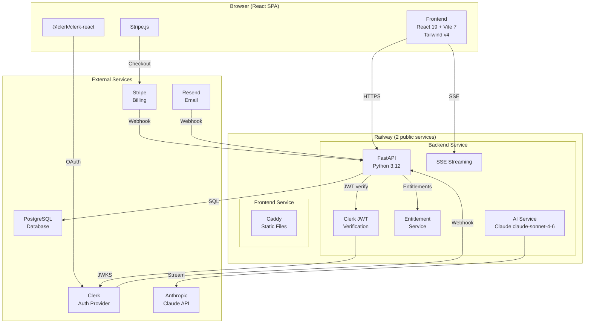
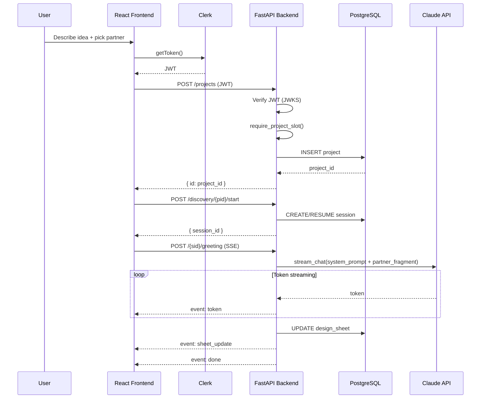
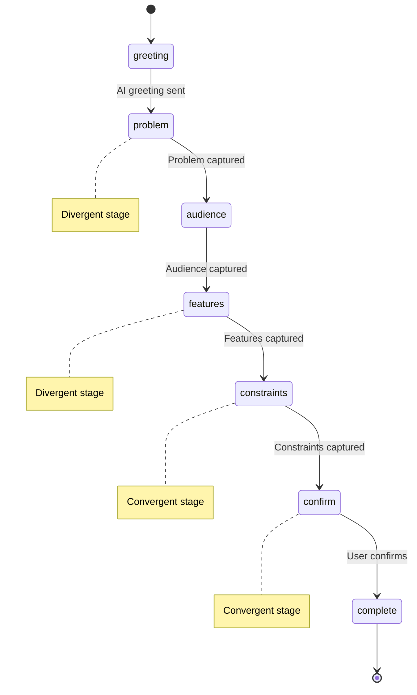
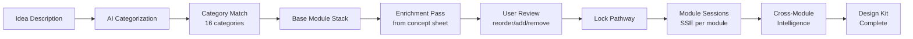
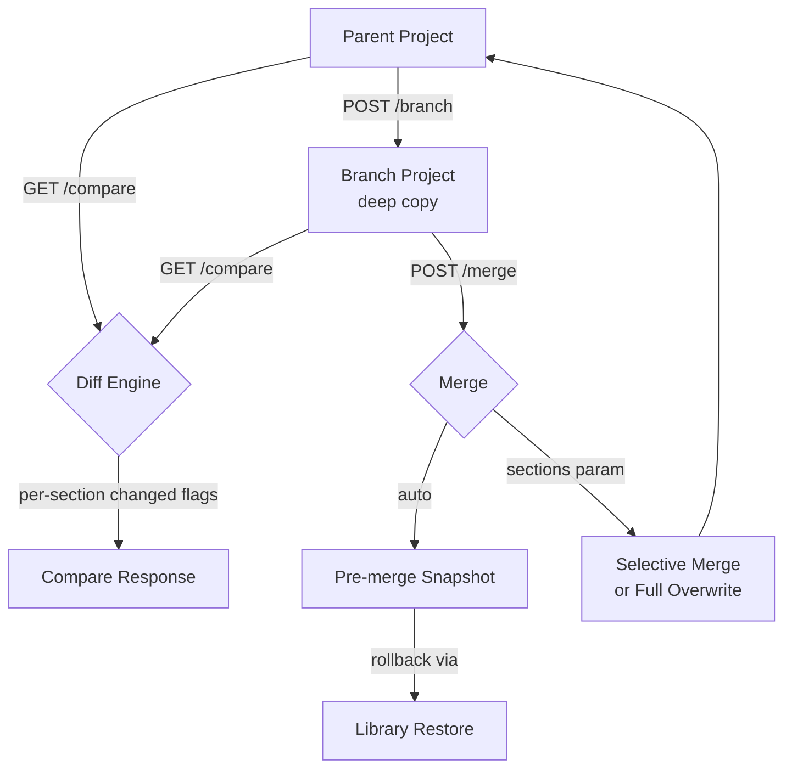
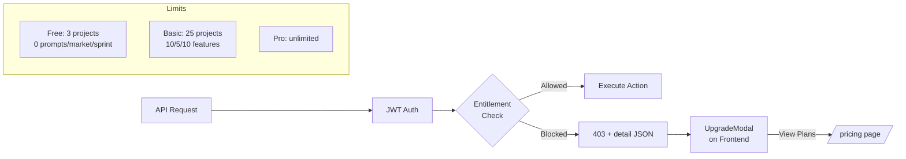

# Ide/AI — Architecture Document

> Last updated: 2026-10-15 (sections moved here from CLAUDE.md, appended at the end)

## Directory Structure
```
Ide_AI/
├── frontend/                  # React/Vite app
│   ├── src/
│   │   ├── components/        # Reusable UI components
│   │   │   ├── ui/            # Base: Button, Card, Input, Badge, Drawer, Modal
│   │   │   ├── layout/        # Sidebar (desktop + mobile bottom nav)
│   │   │   ├── nebula/        # IdeaNebulaCanvas (canvas animation)
│   │   │   ├── auth/          # ProtectedRoute (Clerk auth gate)
│   │   │   ├── partner/       # PartnerCard, PartnerSelector, ActivePartnerBadge
│   │   │   ├── home/          # PresetCard, TemplateGrid
│   │   │   ├── discovery/     # ChatBubble, TopBar, SheetSidebar, QuickChips
│   │   │   ├── framework/     # DesignSheetPanel, SheetCard, ReadinessScores
│   │   │   ├── blocks/        # BlocksBoard, BlockCard, ScopeSlider
│   │   │   ├── pipeline/      # PipelineCanvas, PipelineCard, CostPanel
│   │   │   ├── promptkit/     # PromptKitPanel, PromptSnippet
│   │   │   ├── projects/      # FolderTree, ProjectCard, VersionTimeline
│   │   │   ├── pitch/         # PitchDocument, SharePanel
│   │   │   ├── sharing/       # ShareDialog, CommentSection, StarRating, FeedbackPanel
│   │   │   ├── voice/         # VoiceMicButton (Web Speech API)
│   │   │   └── tutorial/      # StageInterlude, PulseBeacon, Whisper
│   │   ├── pages/             # Route-level page components
│   │   │   ├── Landing.tsx            # Public landing, pricing
│   │   │   ├── SignInPage.tsx         # Clerk sign-in
│   │   │   ├── SignUpPage.tsx         # Clerk sign-up
│   │   │   ├── CheckoutRedirect.tsx   # Stripe post-checkout
│   │   │   ├── Home.tsx               # Idea input, partner grid, templates
│   │   │   ├── Discovery.tsx          # SSE chat with AI partner
│   │   │   ├── Blocks.tsx             # Feature blocks board
│   │   │   ├── Pipeline.tsx           # Stack recommendation canvas
│   │   │   ├── PromptKit.tsx          # Platform-specific prompt generation
│   │   │   ├── Exports.tsx            # Export generation + snapshots
│   │   │   ├── MarketAnalysis.tsx     # Competitive analysis
│   │   │   ├── SprintPlanner.tsx      # Sprint plan generation
│   │   │   ├── PitchMode.tsx          # Shareable one-page brief
│   │   │   ├── Profile.tsx            # Avatar, bio, billing portal
│   │   │   ├── Inbox.tsx              # Idea inbox
│   │   │   ├── Library.tsx            # Project library with progress metadata
│   │   │   ├── Settings.tsx           # App settings, tutorial reset
│   │   │   ├── SharedProject.tsx      # Public shared view with feedback
│   │   │   ├── PathwayReview.tsx      # Module pathway review/reorder
│   │   │   ├── PathwayExecute.tsx     # Module pathway execution
│   │   │   └── ModuleSession.tsx      # Per-module AI conversation
│   │   ├── stores/            # Zustand: authStore, pathwayStore, modulePathwayStore, tutorialStore
│   │   ├── hooks/             # useSSE, useVoiceInput
│   │   ├── lib/               # apiClient (axios with Clerk auth interceptor)
│   │   ├── types/             # TypeScript interfaces
│   │   └── styles/            # Tailwind v4 CSS globals
│   ├── index.html
│   ├── vite.config.ts
│   └── package.json
│
├── backend/                   # FastAPI app
│   ├── app/
│   │   ├── main.py            # FastAPI app, CORS, router registration
│   │   ├── core/
│   │   │   ├── config.py      # Settings via pydantic-settings
│   │   │   ├── clerk.py       # Clerk JWT verification (JWKS/RS256)
│   │   │   └── database.py    # Async SQLAlchemy engine + session
│   │   ├── models/            # SQLAlchemy ORM models (all UUID PKs)
│   │   │   ├── user.py, project.py, session.py, design_sheet.py
│   │   │   ├── block.py, pipeline_node.py, prompt_kit.py
│   │   │   ├── market_analysis.py, sprint_plan.py, version.py
│   │   │   ├── idea_inbox.py, project_share.py, share_comment.py, share_rating.py
│   │   │   ├── project_template.py, project_snapshot.py
│   │   │   ├── concept_branch.py, external_integration.py
│   │   │   ├── module_pathway.py, module_response.py, module_artifact.py
│   │   │   └── user_memory.py, email_verification.py, password_reset.py
│   │   ├── schemas/           # Pydantic v2 request/response schemas
│   │   ├── routers/           # One file per domain
│   │   │   ├── auth.py                # Clerk-based auth, entitlements
│   │   │   ├── billing.py             # Stripe checkout, portal, webhook
│   │   │   ├── clerk_webhook.py       # Clerk user sync
│   │   │   ├── projects.py            # Project CRUD (entitlement gated)
│   │   │   ├── discovery.py           # SSE chat, idempotent start
│   │   │   ├── blocks.py, pipeline.py, design_sheet.py, exports.py
│   │   │   ├── prompts.py             # Prompt kit (entitlement gated)
│   │   │   ├── market.py              # Market analysis SSE (entitlement gated)
│   │   │   ├── sprints.py             # Sprint plans (ownership checked)
│   │   │   ├── sharing.py             # Sharing with feedback/ratings
│   │   │   ├── library.py             # Library with progress metadata, snapshots
│   │   │   ├── inbox.py, templates.py, meta.py, pathways.py
│   │   │   ├── branching.py           # Deep-copy branching, compare, merge
│   │   │   ├── integrations.py        # External tools (coming_soon)
│   │   │   ├── webhooks.py            # Inbound email (HMAC verified)
│   │   │   └── module_pathway.py, modules.py
│   │   ├── services/          # Business logic
│   │   │   ├── ai_service.py          # Claude API: prompt builder, stream_chat
│   │   │   ├── partner_style_service.py  # 10 AI partner styles + prompt fragments
│   │   │   ├── discovery_service.py   # Session management, stage progression
│   │   │   ├── pathway_service.py     # 4 concept pathway definitions
│   │   │   ├── sheet_service.py       # Design sheet CRUD + block generation
│   │   │   ├── pipeline_service.py    # Stack recommendation, cost estimation
│   │   │   ├── export_service.py      # MD/PDF/DOCX/ZIP generation
│   │   │   ├── prompt_kit_service.py, prompt_package_service.py
│   │   │   ├── market_service.py, market_export_service.py
│   │   │   ├── sprint_service.py, email_service.py
│   │   │   ├── categorization_service.py, modular_pathway_service.py, module_service.py
│   │   │   ├── entitlement_service.py  # Plan limits (free/basic/pro)
│   │   │   └── sharing_service.py, library_service.py, memory_service.py, transcript_service.py
│   │   ├── alembic/versions/  # DB migrations (001–023, linear chain)
│   │   └── templates/         # Jinja2 templates for prompts + exports
│   ├── tests/                 # Unit + integration tests
│   ├── pyproject.toml, Dockerfile, railway.toml
│
├── project_templates.seed.json
├── docker-compose.yml
├── CLAUDE.md, CONTEXT_HANDOFF.md, ARCHITECTURE.md
└── AI_PARTNER_SELECTOR_SPEC.md
```

## Database Schema (Key Tables)
```
users               id, email, clerk_user_id, email_verified, account_type, bio, inbox_email, stripe_customer_id, avatar_url, preferences JSONB
projects            id, user_id, name, description, accent_color, platform, audience, complexity, tone, pathway_id, ai_partner_style, primary_category, secondary_category
sessions            id, project_id, status (active|complete), stage, messages JSONB, ai_partner_style
design_sheets       id, project_id (unique), problem, audience, mvp, features JSONB, tone, platform, tech_constraints, success_metric, fields_data JSONB, confidence_score
blocks              id, project_id, name, description, category, priority (mvp|v2), effort (S|M|L), order, is_mvp
pipeline_nodes      id, project_id, layer, selected_tool, config JSONB
prompt_kits         id, project_id, platform, content TEXT, version INT
market_analyses     id, project_id (unique), user_id, target_market JSONB, competitive_landscape JSONB, market_metrics JSONB, revenue_projections JSONB, marketing_strategies JSONB, status
sprint_plans        id, project_id, user_id, status, milestones JSONB, sprints JSONB, timeline JSONB
project_snapshots   id, project_id, user_id, name, description, snapshot_data JSONB, version INT
project_shares      id, project_id, token, allow_feedback, allow_ratings, expires_at, password_hash
share_comments      id, share_id, author_name, content
share_ratings       id, share_id, block_id, score (1-5)
idea_inbox_items    id, user_id, subject, body, source, sender_email, partner_style, provider_event_id
module_pathways     id, project_id, modules JSONB, lite_deep_settings JSONB, status
module_responses    id, project_id, module_id, responses JSONB, status, completed_at
concept_branches    id, parent_project_id, branch_project_id, branch_name, description, created_by
user_integrations   id, user_id, provider, encrypted_token, status
project_templates   id, category, name, description, prefill JSONB
user_memory         id, user_id, key, value
```

## Auth & Billing Architecture
- **Clerk** handles all sign-in/sign-up (email/password + Google, Microsoft, GitHub OAuth)
- Clerk webhook (`POST /webhooks/clerk`) syncs user records to local DB
- Backend verifies Clerk session JWTs via JWKS/RS256 (`core/clerk.py`)
- Frontend attaches Clerk session token via `apiClient.ts` interceptor
- **Stripe** handles subscription billing (Basic Monthly/Yearly, Pro Monthly/Yearly)
- Stripe webhook syncs `stripe_customer_id` and subscription status
- `entitlement_service.py` enforces plan limits: project count, prompt kits, market analysis

## AI Service Design
- All Claude calls go through `ai_service.py` (model: claude-sonnet-4-6)
- 3-layer prompt composition: (1) Base pathway persona → (2) Partner style fragment → (3) Session context
- 10 AI partner styles change collaboration behavior (not cosmetic) — partner choice never alters structured output schema
- Discovery uses a state machine: stages defined per pathway (divergent/convergent mix)
- Confidence score computed after each turn (0–100) based on design_sheet field completeness
- SSE streaming: FastAPI StreamingResponse with `text/event-stream`, frontend uses EventSource
- Module system: per-module SSE conversations with `[MODULE_COMPLETE]` and `[CHIPS:]` markers

## Modular Pathway System
- 16 concept categories (software, food, film, fashion, etc.)
- 47-module library with Lite (2–3 questions) / Deep (6–10 questions) modes
- Categorization: AI analyzes project name + description + concept sheet
- Assembly: base stack (from category) → enrichment pass (from concept sheet) → user review
- Cross-module intelligence: 7 field mapping rules pre-populate from earlier modules
- Seed data: `concept_categories.seed.json`, `module_library.seed.json`

## Security
- JWT verification with Clerk JWKS (issuer/audience/authorized-party validation via env vars)
- Ownership checks on all project-scoped endpoints (sharing, sprints, branching)
- Share expiry enforcement on comments, ratings, CSV export
- Inbound email webhook HMAC verification via Svix (Resend)
- Private share viewer tokens: JWT (HS256, 6hr) for password-protected share feedback
- External integration tokens encrypted with Fernet
- Centralized entitlement guards (`require_project_slot`, `require_feature_usage`) on all creation paths
- 256KB payload limit on inbound email webhook

---

## System Architecture Diagram



## Request Lifecycle



## Discovery State Machine



## Modular Pathway Flow



## Branching & Merge



## Entitlement Gate Flow



## API Documentation

FastAPI auto-generates interactive API docs:

| Endpoint | Format | URL |
|----------|--------|-----|
| Swagger UI | Interactive | `/api/docs` |
| ReDoc | Reference | `/api/redoc` |
| OpenAPI JSON | Machine-readable | `/api/docs/openapi.json` |

All routes are prefixed with `/api/v1`. The OpenAPI spec is generated from Pydantic models and route decorators automatically.

> Moved from `CLAUDE.md` on 2026-10-15.

## What This Software Does

Ide/AI takes a rough idea and turns it into a structured, export-ready design kit before the user ever opens a builder tool. The core problem it solves: people waste credits, time, and money figuring out what to build inside metered platforms (Bubble, Cursor, Claude Code, Bolt, etc.) when that planning should happen beforehand in a purpose-built environment.

The full process takes 15–30 minutes: describe an idea, configure options, go through an AI-guided discovery conversation, and walk away with a prioritized feature breakdown, tech stack recommendation, platform-specific prompts, and exportable documentation.

---

> Moved from `CLAUDE.md` on 2026-10-15.

## Tech Stack

| Layer | Stack |
|-------|-------|
| Backend | Python 3.12, FastAPI, SQLAlchemy 2.0 (async), Alembic, PostgreSQL, Anthropic Claude API (claude-sonnet-4-6) |
| Frontend | React 19.2, TypeScript, Vite 7.3, Tailwind CSS v4 (CSS-based config, no tailwind.config.js), Framer Motion, Zustand |
| Auth | **Clerk** (Google/Microsoft/GitHub OAuth + email/password) — migrated from custom JWT |
| Billing | **Stripe** — checkout sessions, billing portal, webhook sync |
| Email | Resend API — inbound email webhooks for Idea Inbox |
| Deployment | Railway (2 services — backend + frontend exposed publicly), Docker |
| Observability | **Sentry** (backend `sentry-sdk[fastapi]`, frontend `@sentry/react` via dynamic import — both no-op until `SENTRY_DSN`/`VITE_SENTRY_DSN` set) · weekly pg_dump backup + 30-min uptime checks via GitHub Actions |
| Rate limiting | **slowapi** per-IP limits (X-Forwarded-For aware) on public sharing comments/ratings/verify, inbound-email webhook, `/pathways/detect` · `RATE_LIMIT_ENABLED` flag (tests disable) |
| AI Streaming | Server-Sent Events (SSE) for discovery chat, market analysis, module responses |
| Export | fpdf2 (PDF), python-docx (DOCX), Jinja2 templates, ZIP bundling |

---

> Moved from `CLAUDE.md` on 2026-10-15.

## Project Structure

```
C:\Users\vybec\OneDrive\Documents\Development\Ide_AI\
├── backend/
│   ├── app/
│   │   ├── main.py                    # FastAPI app, CORS, router registration
│   │   ├── core/
│   │   │   ├── config.py              # Settings from env vars (pydantic-settings)
│   │   │   ├── clerk.py               # Clerk JWT verification (JWKS/RS256)
│   │   │   └── database.py            # Async SQLAlchemy engine + session
│   │   │
│   │   ├── models/                    # SQLAlchemy ORM models (all UUID PKs)
│   │   │   ├── user.py                # User account (email/password + OAuth, email_verified, account_type, bio, inbox_email)
│   │   │   ├── project.py, session.py, design_sheet.py
│   │   │   ├── block.py, pipeline_node.py, prompt_kit.py
│   │   │   ├── market_analysis.py, sprint_plan.py, version.py, password_reset.py
│   │   │   ├── email_verification.py  # Legacy (now handled by Clerk)
│   │   │   ├── idea_inbox.py          # Inbound email → idea items
│   │   │   ├── project_share.py       # Sharing with feedback/ratings toggles
│   │   │   ├── share_comment.py       # Comments on shared projects
│   │   │   ├── share_rating.py        # Star ratings on shared project blocks
│   │   │   ├── project_template.py    # Seed template definitions
│   │   │   ├── concept_branch.py      # Git-like project forking
│   │   │   ├── external_integration.py # OAuth tokens for external tools
│   │   │   ├── module_pathway.py, module_response.py, module_artifact.py
│   │   │   ├── project_snapshot.py, user_memory.py
│   │   │   ├── admin_audit_log.py     # Append-only admin action log
│   │   │   └── blog_post.py           # Blog posts (public read + admin CMS)
│   │   ├── schemas/                   # Pydantic v2 request/response schemas
│   │   ├── routers/                   # FastAPI route handlers
│   │   │   ├── admin.py               # Admin dashboard (user management, audit log)
│   │   │   ├── auth.py                # Clerk-based /me, avatar, profile, entitlements
│   │   │   ├── billing.py             # Stripe checkout, billing portal, webhook
│   │   │   ├── clerk_webhook.py       # Clerk user sync (create/update/delete)
│   │   │   ├── projects.py            # Project CRUD (with entitlement gate)
│   │   │   ├── discovery.py           # SSE chat, greeting, partner switching (idempotent start)
│   │   │   ├── meta.py                # GET /meta/partner-styles
│   │   │   ├── pathways.py            # GET /pathways, POST /pathways/detect (authenticated)
│   │   │   ├── blocks.py, pipeline.py, design_sheet.py, exports.py
│   │   │   ├── market.py              # Market analysis SSE (with entitlement gate)
│   │   │   ├── sprints.py             # Sprint plans (with ownership checks)
│   │   │   ├── sharing.py             # Project sharing with feedback/ratings, ownership checks
│   │   │   ├── library.py             # Library listing with progress metadata, snapshots, .ideai
│   │   │   ├── prompts.py             # Prompt kit generate/rewrite (with entitlement gate)
│   │   │   ├── inbox.py               # Idea inbox CRUD + build-to-project
│   │   │   ├── templates.py           # GET /templates (seed data)
│   │   │   ├── branching.py           # Concept branching (deep copy, compare, merge)
│   │   │   ├── integrations.py        # External tool integrations (coming_soon)
│   │   │   ├── webhooks.py            # Inbound email webhook (HMAC verified)
│   │   │   ├── blog.py                # Blog: public read + admin CMS (audit-logged)
│   │   │   └── module_pathway.py, modules.py
│   │   ├── services/                  # Business logic
│   │   │   ├── ai_service.py          # build_system_prompt(), build_greeting_prompt(), stream_chat()
│   │   │   ├── artifact_context_service.py # Unified v1/v2 artifact bridge for downstream consumers
│   │   │   ├── audit_service.py       # Append-only admin audit log
│   │   │   ├── partner_style_service.py  # 10 AI partner styles, metadata, prompt fragments
│   │   │   ├── discovery_service.py   # Session management, stage progression, concept-sheet extraction
│   │   │   ├── pathway_service.py     # Concept Pathway registry (4 pathways)
│   │   │   ├── email_service.py       # Resend API: generic send helper
│   │   │   ├── sheet_service.py       # Design sheet CRUD + block generation
│   │   │   ├── pipeline_service.py    # Stack recommendation, cost estimation, compatibility
│   │   │   ├── export_service.py      # MD/PDF/DOCX/ZIP generation
│   │   │   ├── categorization_service.py, modular_pathway_service.py, module_service.py
│   │   │   ├── market_service.py, market_export_service.py, sprint_service.py
│   │   │   ├── prompt_kit_service.py, prompt_package_service.py
│   │   │   ├── entitlement_service.py  # Plan limits (free/basic/pro), feature gates
│   │   │   ├── inbox_pubsub.py        # Redis pub/sub for realtime inbox badge
│   │   │   └── sharing_service.py, library_service.py, memory_service.py, transcript_service.py
│   │   ├── alembic/versions/          # Database migrations (001–033, linear chain)
│   │   └── templates/                 # Jinja2 templates for prompts + exports
│   ├── tests/                         # backend tests across 14 files (306 collected · 305 pass · 1 skip)
│   ├── pyproject.toml, Dockerfile, railway.toml
├── frontend/
│   ├── src/
│   │   ├── pages/
│   │   │   ├── Landing.tsx            # Public landing page with hero, features, pricing
│   │   │   ├── SignInPage.tsx         # Clerk sign-in
│   │   │   ├── SignUpPage.tsx         # Clerk sign-up
│   │   │   ├── CheckoutRedirect.tsx   # Stripe checkout redirect
│   │   │   ├── Home.tsx               # Idea input, partner grid, template grid, project creation
│   │   │   ├── CategorySelect.tsx     # Category selection for modular pathway
│   │   │   ├── Discovery.tsx          # SSE chat UI, partner badge, mid-session switching
│   │   │   ├── DesignKit.tsx          # v2 module responses viewer + editor + action cards
│   │   │   ├── Blocks.tsx             # Feature blocks board
│   │   │   ├── Pipeline.tsx, Exports.tsx, MarketAnalysis.tsx, SprintPlanner.tsx
│   │   │   ├── PromptKit.tsx          # Platform-specific prompt generation
│   │   │   ├── Profile.tsx            # Avatar upload, bio, stats, billing portal link
│   │   │   ├── Admin.tsx              # Admin dashboard (users, audit log)
│   │   │   ├── Inbox.tsx              # Idea inbox list, partner picker, build-to-project
│   │   │   ├── Library.tsx            # Project library with progress metadata, smart resume
│   │   │   ├── Settings.tsx           # App settings, tutorial reset, profile link
│   │   │   ├── SharedProject.tsx      # Public shared view with comments + ratings
│   │   │   ├── PrivacyPolicy.tsx, TermsOfService.tsx
│   │   │   ├── Blog.tsx, BlogPost.tsx  # Public blog index + post (SEO, react-markdown)
│   │   │   ├── PathwayReview.tsx, PathwayExecute.tsx, ModuleSession.tsx
│   │   │   └── PitchMode.tsx
│   │   ├── components/
│   │   │   ├── admin/                 # AdminUserTable, AdminUserDrawer, AdminAuditList, AdminBlogManager
│   │   │   ├── auth/ProtectedRoute.tsx # Clerk auth gate
│   │   │   ├── billing/               # CheckoutRedirect helpers
│   │   │   ├── layout/Sidebar.tsx     # Desktop sidebar + mobile bottom nav, profile container, inbox badge
│   │   │   ├── layout/PublicHeader.tsx # Unified top nav across ALL logged-out pages (landing, legal, blog, auth, shared)
│   │   │   ├── partner/               # PartnerCard, PartnerSelector, ActivePartnerBadge
│   │   │   ├── home/                  # PresetCard, TemplateGrid
│   │   │   ├── discovery/             # ChatBubble, TopBar, ProgressPanel, QuickChips
│   │   │   ├── framework/             # DesignSheetPanel, SheetCard, ReadinessScores
│   │   │   ├── pathway/               # Pathway selection and review components
│   │   │   ├── sharing/               # ShareDialog, CommentSection, StarRating, FeedbackPanel
│   │   │   ├── voice/                 # VoiceMicButton (Web Speech API toggle)
│   │   │   ├── tutorial/              # StageInterlude, PulseBeacon, Whisper, GuidedTour, HelpButton
│   │   │   ├── blog/                  # BlogChrome (public nav/footer/CTA)
│   │   │   ├── nebula/                # Animated background canvas
│   │   │   └── ui/                    # Button, Modal, Card, Input, Badge, Drawer
│   │   ├── stores/                    # Zustand: authStore, pathwayStore, modulePathwayStore, tutorialStore, walkthroughStore, inboxStore, adminStore
│   │   ├── hooks/                     # useSSE, useVoiceInput
│   │   ├── lib/                       # apiClient.ts, authFetch.ts, fieldValue.ts, extractError.ts, plans.ts, categories.ts, exportUtils.ts
│   │   ├── types/                     # TypeScript interfaces (project, discovery, pathway, blocks, pipeline, export, modulePathway)
│   │   └── styles/                    # Tailwind v4 CSS globals
│   ├── vite.config.ts, tsconfig.json, Dockerfile, Caddyfile, railway.toml
├── project_templates.seed.json        # ~25 seed templates across 16 categories
├── docker-compose.yml
├── CLAUDE.md                          # THIS FILE
├── AI_PARTNER_SELECTOR_SPEC.md
├── ARCHITECTURE.md, PRD.md, FEATURE_SPEC.md
├── PRODUCT_DESCRIPTION.md, SYSTEM_PROMPT.md
├── CONTEXT_HANDOFF.md, DEPLOYMENT_RAILWAY.md, PROMPT_SEQUENCE.md
```

---

> Moved from `CLAUDE.md` on 2026-10-15.

## Design System

- **Theme:** Dark glassmorphism — `#0d0d12` background, `bg-white/5` cards, `backdrop-blur`, `border: 1px solid rgba(255,255,255,0.08)`
- **Accent:** Electric cyan `#00E5FF` — `text-accent`, `border-accent`, `bg-accent/10`
- **Selected state:** `bg-accent/5 border-accent shadow-[0_0_16px_rgba(0,229,255,0.1)]`
- **Typography:** Arial (Regular for body, Bold for emphasis, Black for headings), JetBrains Mono (code/prompts)
- **Cards:** 12px radius, glass border, hover `border-white/15` + `scale-[1.02]`
- **Animations:** Framer Motion — page transitions, IdeaNebulaCanvas, skeleton loaders
- **State:** Zustand stores + React Query for server state
- **Tailwind v4:** CSS-based config, no `tailwind.config.js`
- **Notifications:** react-hot-toast
- **Responsive:** sidebar collapses to bottom nav on <768px

---

> Moved from `CLAUDE.md` on 2026-10-15.

## Database Migrations (linear chain)

| # | Description |
|---|-------------|
| 001 | Initial schema (users, projects, sessions, design_sheets, blocks) |
| 002 | Market analyses table |
| 003 | Project snapshots |
| 004 | OAuth + profile fields |
| 005 | User memory |
| 006 | Project shares |
| 007 | Sprint plans |
| 008 | Sprint error message patch |
| 009 | Pathway infrastructure (pathway_id on projects, stages on sessions) |
| 010 | AI partner style (ai_partner_style on projects + sessions) |
| 011 | Modular pathway system (categories on projects, module_pathways, module_responses) |
| 012 | Email verification (email_verified on users, email_verifications table) |
| 013 | User profile fields (account_type, bio on users) |
| 014 | Idea inbox (idea_inbox_items table, inbox_email on users) |
| 015 | Sharing feedback + templates (allow_feedback/allow_ratings on project_shares, share_comments, block_ratings) |
| 016 | Concept branches + external integrations (concept_branches, user_integrations tables) |
| 017 | Seed project templates |
| 018 | Seed category templates |
| 019 | Add stripe_customer_id to users |
| 020 | Add password_resets table (legacy — now handled by Clerk) |
| 021 | Add clerk_user_id to users |
| 022 | Widen avatar_url column to TEXT |
| 023 | Deduplicate user rows (webhook cleanup) |
| 024 | Expand templates to 160 |
| 025 | Inbound email idempotency (provider_event_id unique constraint) |
| 026 | Deduplicate user rows v2 (post-Clerk webhook race cleanup) |
| 027 | Add `users.is_admin` (bool) + `users.entitlement_overrides` (JSONB) |
| 028 | Create `admin_audit_log` table (append-only admin action log) |
| 029 | Add `projects.flow_version` (legacy `v1` vs unified `v2` flow) |
| 030 | Phase-2 hotfix — backfill `module_pathways.modules` shape, dedup `module_responses`, add UNIQUE(project_id, module_id) |
| 031 | Add `sessions.scope_module_ids` (JSONB, nullable) for mini-Discovery scoped sessions |
| 032 | Add Stripe subscription state columns (`stripe_subscription_id`, `subscription_status`, `subscription_price_id`, `subscription_current_period_end`) to users |
| 033 | Create `blog_posts` table (public/admin blog — title, unique slug, Markdown body, excerpt, cover, tags JSONB, published_at, view_count) |

---

> Moved from `CLAUDE.md` on 2026-10-15.

## API Routes (prefix: `/api/v1`)

| Domain | Key Routes |
|--------|------------|
| Auth | `GET /auth/me`, `PATCH /auth/me`, `POST /auth/me/avatar`, `GET /auth/me/entitlements` (Clerk handles sign-in/sign-up) |
| Billing | `POST /billing/checkout`, `POST /billing/portal`, `POST /billing/webhook` |
| Clerk Webhook | `POST /webhooks/clerk` (user sync) |
| Projects | `POST /projects`, `GET /projects/{id}`, `PATCH /projects/{id}` |
| Pathways | `GET /pathways`, `POST /pathways/detect` |
| Meta | `GET /meta/partner-styles` |
| Discovery | `POST /discovery/start` (body: project_id), `POST /discovery/{session_id}/init` (SSE), `POST /discovery/{session_id}/message` (SSE), `PATCH /discovery/{session_id}/partner`, `PATCH /discovery/{session_id}/progress`, `GET /discovery/{session_id}`, `GET /discovery/{session_id}/sheet`, `GET /discovery/{session_id}/field-summary` (v2 only — returns 409 for v1), `GET /discovery/{session_id}/transcript?format=md\|pdf\|txt` |
| Blocks | `GET /projects/{project_id}/blocks`, `POST /projects/{project_id}/blocks`, `POST /projects/{project_id}/blocks/generate`, `PATCH /projects/{project_id}/blocks/{block_id}`, `DELETE /projects/{project_id}/blocks/{block_id}` |
| Pipeline | `GET /projects/{id}/pipeline`, `POST /projects/{id}/pipeline/recommend`, `PATCH /projects/{id}/pipeline/{layer}`, `POST /projects/{id}/pipeline/ui-skeleton` |
| Exports | `GET /projects/{id}/export?format=md\|pdf\|docx\|zip` |
| Market | `POST /market/{project_id}/generate` (SSE), `GET /market/{project_id}`, `GET /market/{project_id}/report`, `GET /market/{project_id}/export` |
| Sprints | `POST /sprints/{project_id}/generate` |
| Sharing | Project share CRUD, `POST/GET /sharing/public/{token}/comments`, `POST/GET /sharing/public/{token}/ratings` |
| Library | `GET /library/projects`, `POST /library/{project_id}/snapshots`, `GET /library/{project_id}/snapshots`, `POST /library/snapshots/{snapshot_id}/restore`, `POST /library/{project_id}/export`, `POST /library/import` |
| Module Pathway | `POST /projects/{project_id}/categorize`, `POST /projects/{project_id}/pathway/assemble`, `GET /projects/{project_id}/pathway`, `PATCH /projects/{project_id}/pathway`, `POST /projects/{project_id}/pathway/lock`, `GET /projects/{project_id}/design-kit`, `POST /projects/{project_id}/pathway/modules` |
| Modules | `POST /modules/{id}/{module_id}/start` (SSE), `POST /modules/{id}/{module_id}/respond` (SSE), `POST /modules/{id}/{module_id}/skip`, `GET /modules/{id}/{module_id}/summary`, `PATCH /modules/{id}/{module_id}/responses`, `POST /modules/{id}/{module_id}/refresh-output` |
| Inbox | `GET /inbox`, `POST /inbox`, `GET /inbox/count`, `GET /inbox/stream` (SSE), `POST /inbox/{id}/promote`, `DELETE /inbox/{id}` |
| Templates | `GET /templates` |
| Blog | **Public:** `GET /blog/posts`, `GET /blog/posts/{slug}` · **Admin (require_admin):** `GET/POST /blog/admin/posts`, `GET/PATCH/DELETE /blog/admin/posts/{id}` |
| Branching | `POST /branching/{project_id}/branch`, `POST /branching/{project_id}/merge/{branch_id}`, `GET /branching/{project_id}/branches`, `GET /branching/{project_id}/compare/{branch_id}` |
| Integrations | `GET /integrations`, `POST /integrations`, `PATCH /integrations/{id}`, `DELETE /integrations/{id}`, `GET /integrations/providers` · **Notion (live):** `POST /integrations/notion/authorize`, `GET /integrations/notion/callback`, `GET /integrations/notion/pages`, `POST /integrations/notion/push/{project_id}` |
| Webhooks | `POST /webhooks/inbound-email` |
| Admin | `GET /admin/users`, `GET /admin/users/{id}`, `PATCH /admin/users/{id}/plan`, `PATCH /admin/users/{id}/overrides`, `PATCH /admin/users/{id}/admin`, `GET /admin/audit-log` |

---

> Moved from `CLAUDE.md` on 2026-10-15.

## Known Issues

1. **Node.js v24 + Vite 7 ESM:** Local preview tool can't run Vite dev server due to ESM/require() incompatibility. Builds verified via `tsc -b` and `vite build`. _(2026-05-31: `scripts/prerender.mjs` now uses `pathToFileURL()` for the SSR import, so the full `npm run build` — incl. prerender — also runs cleanly on Windows.)_
2. **C: drive space:** Vite builds may fail if C: is full. Use `TMPDIR=D:/tmp` when building locally.
3. **Integration tests:** 4 tests in `backend/tests/test_partner_style.py` require the `anthropic` module (only on Railway). The 24 unit tests run locally with just pytest.
4. **PartnerSelector component** is used in `Discovery.tsx` for mid-session switching. It was removed from `Home.tsx` in favor of the inline grid.
5. **CSP / Clerk production domain (`frontend/Caddyfile`):** the CSP **must** allow the Clerk production custom domain `https://clerk.myide.ai` (in `script-src` / `connect-src` / `img-src` / `frame-src`) **and** the backend **origin with no path** in `connect-src`. Dropping the first white-screens the whole SPA (Clerk SDK blocked); dropping the second blocks every `/api/v1/*` call (no profile name, no Admin link). Guard comments are in the Caddyfile — see the 2026-05-30 CSP incident in [CONTEXT_HANDOFF.md](CONTEXT_HANDOFF.md). A path-scoped `connect-src` entry (e.g. `…/api/v1`) does **not** match sub-paths.
6. **Blog SEO is client-rendered (fast-follow available):** `/blog` and `/blog/:slug` set full Helmet meta + JSON-LD but fetch content client-side (Googlebot renders JS, so they index). For best-in-class GEO/AI-crawler coverage, extend `scripts/prerender.mjs` + `entry-server.tsx` to fetch published posts at build and statically prerender each post (+ append them to `sitemap.xml`). Deferred because it couples the frontend build to backend availability at build time. Blog images (`cover_image_url`) load from external URLs — if a future CSP tightens `img-src`, allow the image host.

---

